# 🩺 Clinic Management System

**From the front desk to the doctor's notes to the receipt, for a small clinic that takes patient privacy seriously.**

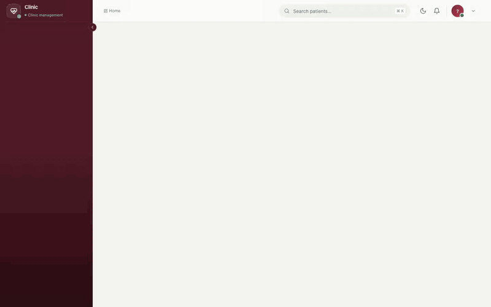

> Product showcase with demo data. A live walkthrough is available on request.

---

## One patient's visit

| Step | Who | What happens in the app |
|---|---|---|
| 1. **Register** | Reception | Patient gets a medical record number; duplicates are flagged by name, birth date and phone. Privacy consent is recorded. |
| 2. **Book** | Reception | Pick a doctor and a time slot. Overlapping bookings are refused, even when two people book the same slot at the same moment. |
| 3. **Check in** | Reception | The patient appears in today's queue, with a red flag if they have allergies. Walk-ins go straight to the queue. |
| 4. **Consult** | Doctor | Vitals, notes, ICD-10 diagnoses and prescriptions, autosaved as a draft. Signing locks the record; later changes become versioned amendments. |
| 5. **Bill** | Reception | The invoice is built from the visit, with extra services and discounts. Payments by cash, card, bank transfer or e-wallet; part payments allowed. PDF invoices. |
| 6. **Review** | Admin | Revenue and appointment reports with CSV export, and an audit trail of every change and every record view. |

**Roles:** Admin · Doctor · Receptionist, each seeing only the screens and actions their role allows.

---

## Privacy built in

Medical records are the most sensitive data a small business holds, so protection is part of the design, not
an add-on.

- **Encrypted at rest:** consultation notes and prescriptions are encrypted in the database. A documented key
  custody and rotation process (with a resumable re-encryption command) keeps them recoverable.
- **Every read is logged:** opening a medical record writes an audit entry first. If that entry can't be written,
  the record isn't shown at all.
- **The log can't be edited:** database triggers block any update or delete on the audit table.
- **Least-privilege database:** the running app's database user can read and write data but can't change the
  schema; migrations use a separate user.
- **Signed means signed:** a signed consultation can't be edited, only amended with a reason, and every version
  is kept.
- **Secure sign-in:** optional or required two-factor authentication (TOTP with recovery codes), login rate
  limits, idle session timeout, strict security headers.
- **No lost updates:** optimistic locking stops two staff members from overwriting each other's changes.

---

## Built with

| | |
|---|---|
| Backend | **PHP 8.3**, **Laravel 13**, Sanctum (SPA cookie auth), Form Requests, Policies, service layer |
| Frontend | **Vue 3**, TypeScript, Vite, Vue Router, Pinia, Tailwind CSS 4 |
| Database | **MySQL 8**: triggers, indexed queries, encrypted columns |
| Testing | PHPUnit (386 tests, including a full role-permission matrix and concurrent-booking tests), Vitest (72), **Playwright** end-to-end (19) |
| Code quality | Larastan level 6, Pint, ESLint, `vue-tsc`, `composer audit`, `npm audit` |
| DevOps | GitHub Actions CI/CD, Docker image (Nginx + PHP-FPM), end-to-end tests run against the exact image that ships |
| Hosting | Runs on any Ubuntu server: **AWS EC2**, **Azure** VMs or **DigitalOcean** Droplets |

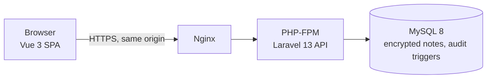

More diagrams, including a visit from booking to payment: [`docs/architecture.md`](docs/architecture.md).

**Performance:** benchmarked through the full HTTP stack on a dataset of 500,000 patients, 5 million
appointments and 50 million audit rows, against targets of under 500 ms for lists and search and under 300 ms
for single records. Every list and filter query is checked to use an index.

---

## Gallery

| | | |
|---|---|---|
| 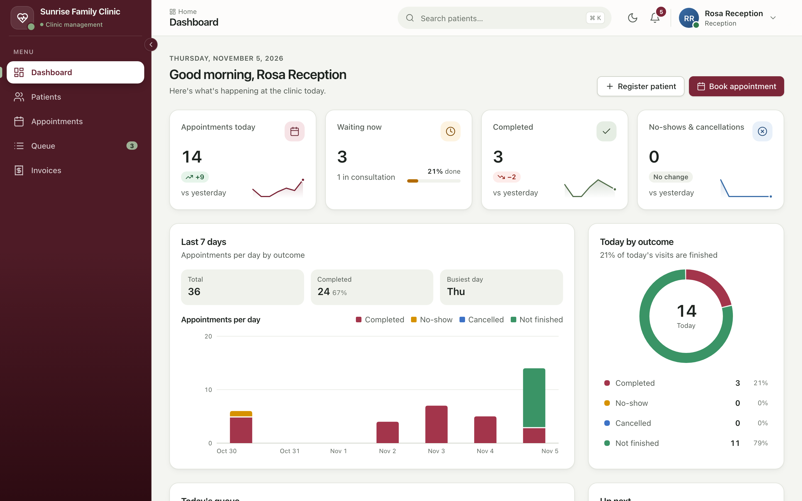 | 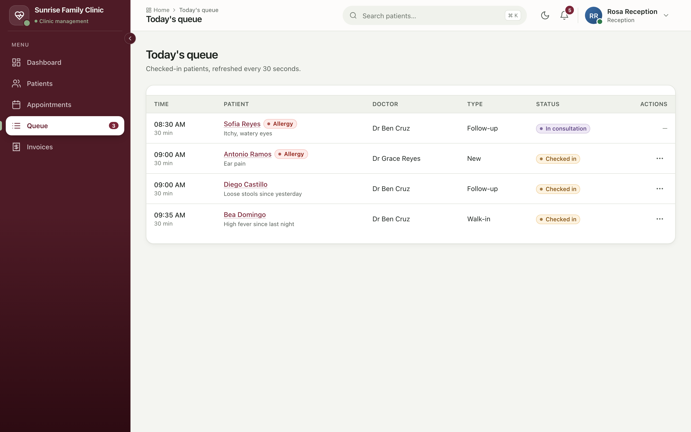 | 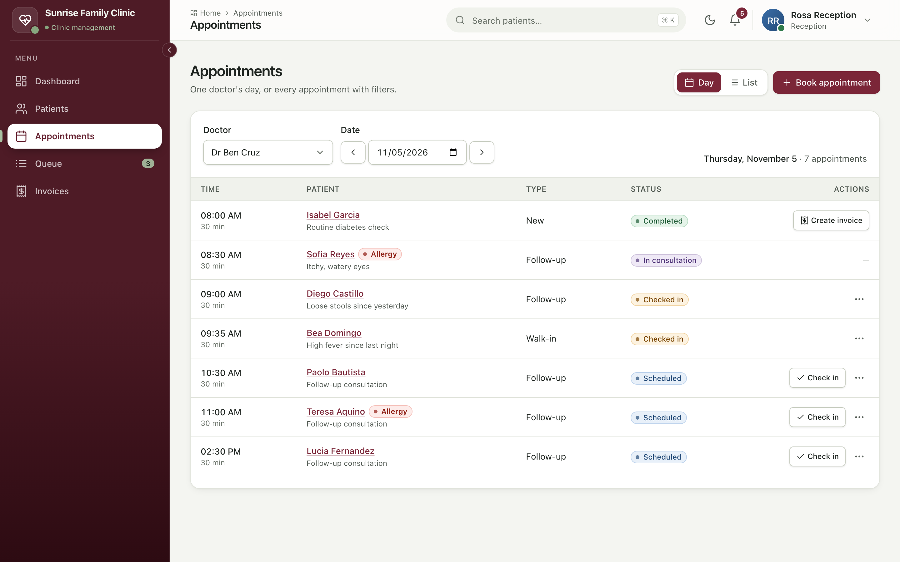 |
| Dashboard | Today's queue | A doctor's day |
| 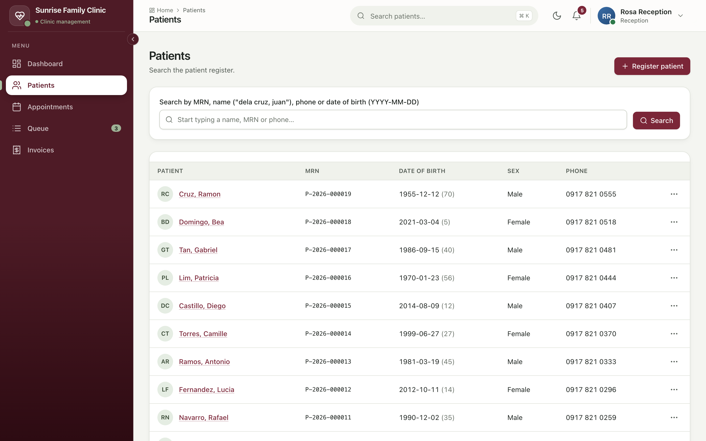 | 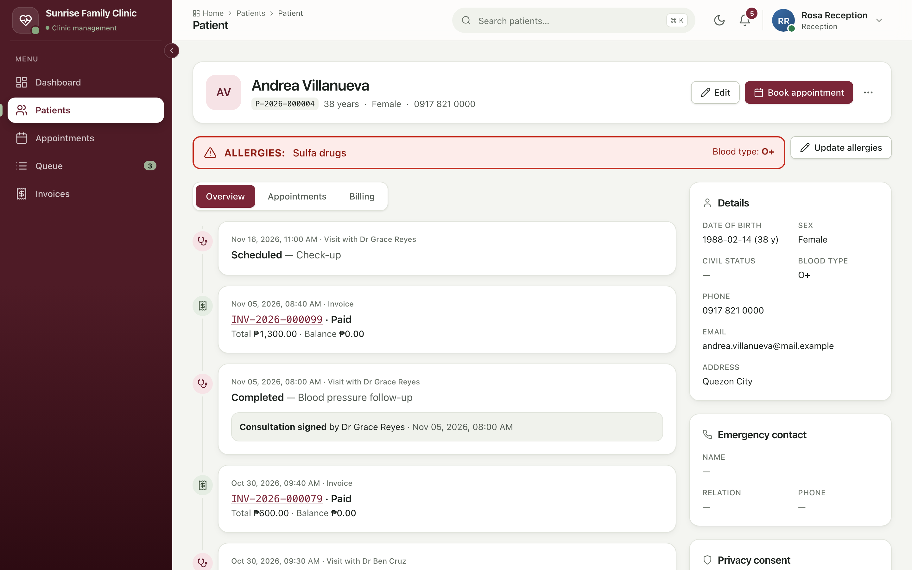 | 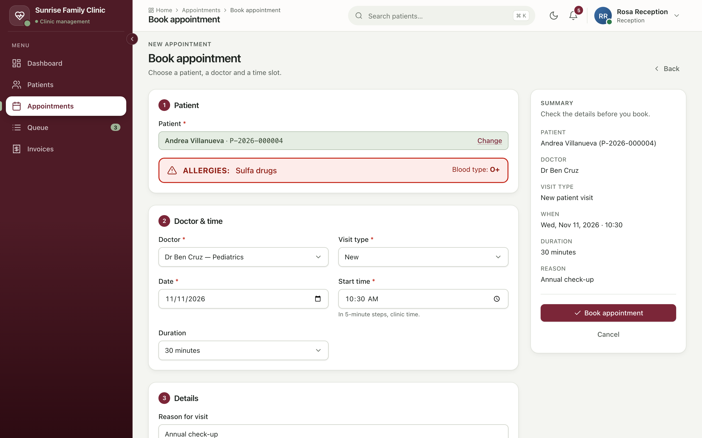 |
| Patient register | Patient record with allergy alert | Booking an appointment |
| 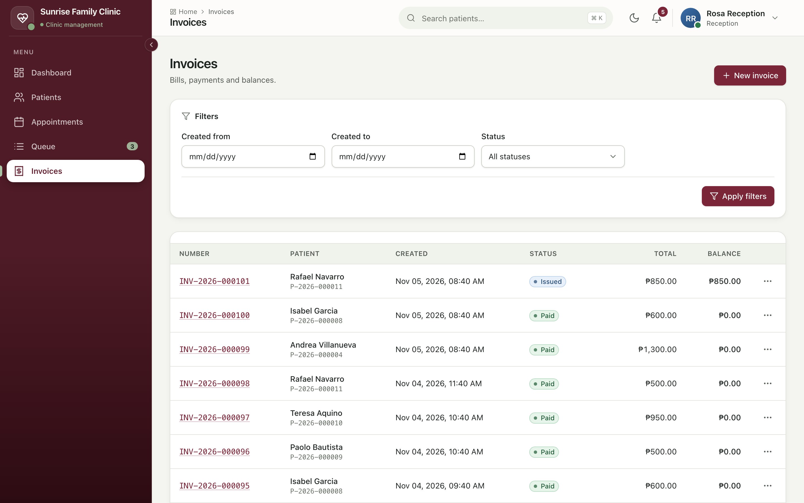 | 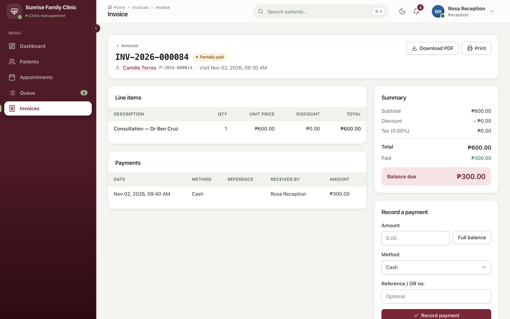 | 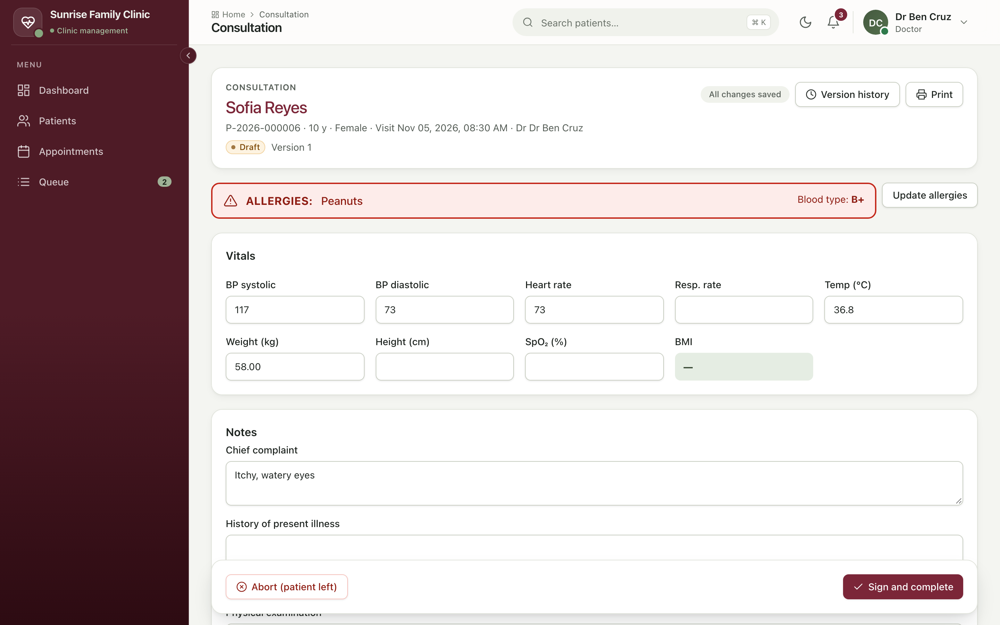 |
| Invoices | Invoice with part payment | Consultation in progress |
| 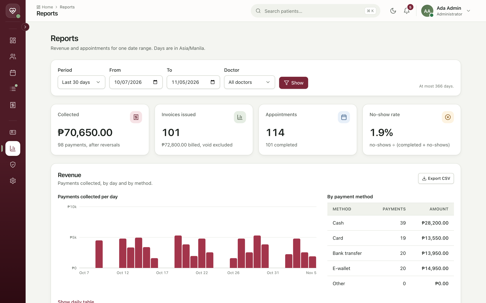 | 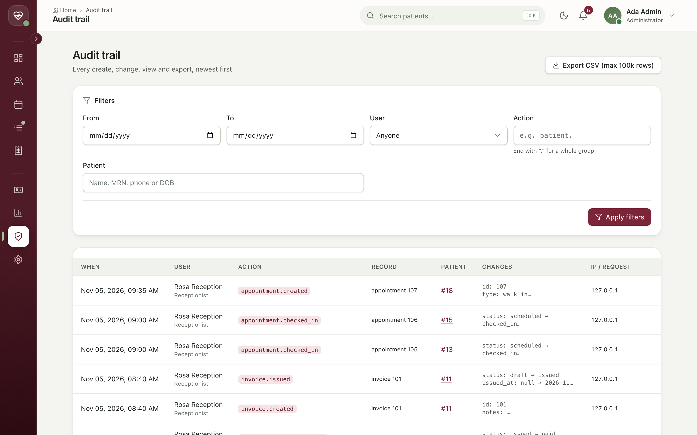 | |
| Reports | Audit trail | |

Clinic, staff and patients are demo data.

---

## About me

Full-stack developer working with **PHP, Laravel, Vue and MySQL**, as well as Python and TypeScript stacks. I
built this system end to end: data model, API, UI, security, tests and deployment.
